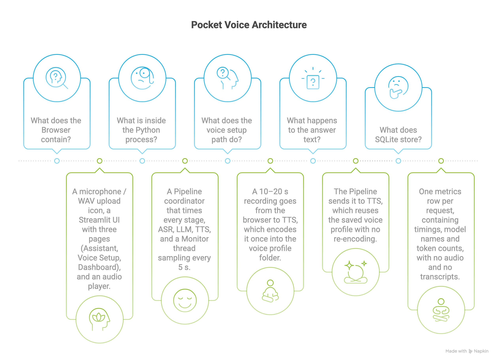

<div align="center">

# 🎙️ Pocket Voice

**A voice assistant that answers in _your own voice_.**
Speak a question → get a spoken answer in a voice cloned from a short recording of you,
with a live dashboard that shows what it costs in CPU, memory and latency.

[PocketTTS](https://github.com/kyutai-labs/pocket-tts) (your voice, on CPU) · [Groq](https://console.groq.com/docs) (speech recognition + answers) · [Streamlit](https://streamlit.io) · psutil · SQLite

</div>

> ⚠️ **Voice profile ≠ training.** PocketTTS *conditions* on a short recording and saves a reusable voice state. No model weights are fine-tuned.
> Use only your **own** voice, or a voice you have **explicit permission** to use. All speech is **AI-generated**.

---

## Contents
[Aim](#-aim) · [What you get](#-what-you-get) · [How it works](#-how-it-works) · [Architecture](#-architecture) · [Quick start](#-quick-start-github-codespaces) · [Using the app](#-using-the-app) · [Customize](#-customize-it) · [Dashboard](#-the-dashboard) · [How lightweight?](#-how-lightweight-is-it) · [Tests & benchmark](#-tests-and-benchmark) · [Privacy](#-privacy-and-security) · [Troubleshooting](#-troubleshooting) · [Licenses](#-dependencies-and-licenses) · [Limitations](#-known-limitations)

---

## 🎯 Aim
Show that a talking assistant with a **personal voice** can be small, simple and measurable:

| Goal | How |
|---|---|
| **Your voice, quickly** | A 10–20 s recording becomes a reusable voice profile. No training run, no GPU. |
| **Small footprint** | Speech recognition and the language model run on Groq. The machine runs only one compact text-to-speech model. |
| **Visible performance** | A dashboard shows CPU, memory, disk, network and the latency of every stage, from real measurements. |
| **Easy to run** | One Python app. No Docker, database server, Prometheus, Grafana or Kubernetes required. |

---

## ✨ What you get
- 🎤 **Voice Setup:** upload or record your voice, preview it, build a profile, test it, replace or delete it.
- 💬 **Assistant:** click the mic **or type** a question, see the transcript and answer, and hear it in your voice. Conversation history is kept.
- 📊 **Dashboard:** system resources and voice/API performance, with 15 min / 1 h / 24 h ranges.
- 🛡️ **Privacy defaults:** local storage of voice data, server-side API key, optional password, no audio or transcripts in analytics.
- 🧪 **Tests and a benchmark script** for the voice, Groq (mocked), monitoring and storage code.

---

## 🔄 How it works
1. **Voice setup (once).** You provide 10–20 s of speech. PocketTTS encodes it into a *voice state*, saved to `data/voice/profile.safetensors`. After that the saved state is loaded from disk and the recording isn't re-processed.
2. **Ask.** The browser mic produces a WAV. Empty or silent audio is rejected before any API call.
3. **Transcribe.** Groq Whisper converts the WAV to text, shown in the chat.
4. **Answer.** The text and recent history go to a Groq chat model with your system prompt. The reply and token usage come back.
5. **Speak.** PocketTTS turns the reply into speech in your voice, on CPU. The browser plays it.
6. **Record metrics.** Each stage is timed. One row per request goes to SQLite: timings, durations, model names, token counts, error category and text *lengths*. No audio, no transcripts.
7. **Monitor.** A background thread samples psutil every 5 s into memory and writes one row to SQLite every 30 s. Live dashboard values never depend on the database.

Pipeline: `mic → Groq Whisper → Groq chat model → PocketTTS (your voice) → speaker`

---

## 🧱 Architecture


| File | Responsibility |
|---|---|
| [app/Home.py](app/Home.py) | Assistant page: mic → answer → audio, status stages, history |
| [app/pages/1_Voice_Setup.py](app/pages/1_Voice_Setup.py) | Create, test and delete the voice profile |
| [app/pages/2_Dashboard.py](app/pages/2_Dashboard.py) | System and voice analytics (Plotly) |
| [app/pipeline.py](app/pipeline.py) | One turn: ASR → LLM → TTS, per-stage timing, error categories, metrics row |
| [app/tts.py](app/tts.py) | Cached PocketTTS model, build/load/delete profile, one synthesis at a time |
| [app/asr.py](app/asr.py), [app/llm.py](app/llm.py) | Groq calls (optional local Whisper backend) |
| [app/monitor.py](app/monitor.py) | psutil collectors and the background sampler |
| [app/store.py](app/store.py) | SQLite schema, queries, retention, summary statistics |
| [app/config.py](app/config.py), [app/errors.py](app/errors.py), [app/audio.py](app/audio.py), [app/ui.py](app/ui.py) | Env settings, error categories, WAV helpers, page setup and password gate |
| [scripts/benchmark_tts.py](scripts/benchmark_tts.py) | Measures real model load time, speed, RAM and CPU |

---

## 🚀 Quick start (GitHub Codespaces)

**1. Push the repo to GitHub** (Codespaces opens from a GitHub repo).

**2. Add secrets**, in the repo under *Settings → Secrets and variables → Codespaces*:

| Secret | Required | Purpose |
|---|---|---|
| `GROQ_API_KEY` | ✅ | Your [Groq](https://console.groq.com) API key (server-side only) |
| `HF_TOKEN` | ✅ for voice cloning | A Hugging Face **read** token. The cloning weights are gated: first accept the terms at [huggingface.co/kyutai/pocket-tts](https://huggingface.co/kyutai/pocket-tts) while logged in, then create a token at [Settings → Tokens](https://huggingface.co/settings/tokens). |
| `APP_PASSWORD` | optional | Password gate for the app |

Add them *before* creating the Codespace, or restart it afterwards.

**3. Create the Codespace:** *Code → Codespaces → Create codespace on main*. A 4-core machine is recommended. The devcontainer installs `uv` and runs `uv sync` (CPU-only PyTorch, so the first setup takes a few minutes).

**4. Start the app**
```bash
./run.sh
```
If `uv` isn't found, run `export PATH="$HOME/.local/bin:$PATH"` first. If `./run.sh` is "permission denied", run `chmod +x run.sh`.

**5. Open it:** click the **Open in Browser** popup, or use the **Ports** tab and open port **8501**. Keep the port **Private**. It is served over HTTPS, so the browser microphone works.

**6. First use**
1. **Voice Setup** → upload or record 10–20 s of clear speech → tick the consent box → **Create / replace voice profile**. The first run downloads the PocketTTS weights from Hugging Face, so it takes longer.
2. Click **Speak** to hear the test sentence.
3. **Assistant** → click the mic → ask a question.
4. **Dashboard** → see the performance numbers.

Model weights are cached in `.cache/huggingface` and your profile is saved in `data/`. Both survive stopping and restarting the Codespace, but not deleting it.

### Other environments (not yet tested)
<details>
<summary><b>Local (macOS / Linux)</b></summary>

```bash
uv sync
cp .env.example .env      # then put your GROQ_API_KEY and HF_TOKEN in it
./run.sh
```
Needs about 1–2 GB of free disk for PyTorch and the model. The app reads the `.env` file in the project folder by itself, so there is nothing to export.
</details>

<details>
<summary><b>Docker</b></summary>

```bash
docker build -t pocket-voice .
docker run -e GROQ_API_KEY=your_key -p 8501:8501 -v pv-data:/data pocket-voice
```
The `pv-data` volume keeps your voice profile, model cache and database between runs.
</details>

---

## 🧭 Using the app

| Page | What to do |
|---|---|
| **Voice Setup** | Read the on-screen passage while recording in the browser, or upload a WAV, MP3, FLAC or OGG file. Preview it. Tick consent, then create the profile. Test with any sentence. Re-upload to replace the profile, or delete it with one click. |
| **Assistant** | Click the mic to start and stop recording. Status shows Ready → Transcribing → Generating response → Generating speech → Completed (or Failed with the reason). The sidebar lets you edit the system prompt and clear the conversation. |
| **Dashboard** | Pick a time range. The **System** tab shows resources. The **Voice & usage** tab shows latency, requests, models and errors. It refreshes every 5 s while open. |

**Tips for a good voice profile:** a quiet room, one speaker, 10–20 s of natural speech, and no music or background noise. Recordings must be at least 5 s. Longer ones are **trimmed to the first 20 s** automatically (anything over 10 minutes is rejected). Upload formats: WAV, MP3, FLAC, OGG (not M4A/AAC: convert with `afconvert -f WAVE -d LEI16@16000 -c 1 in.m4a out.wav` on a Mac).

---

## 🛠️ Customize it

### Settings (environment variables)
Put them in a `.env` file in the project folder (copy [.env.example](.env.example)), or set them in your shell, Docker `-e`, or Codespaces secrets. The app loads `.env` at startup, so restart it after editing. Variables already set in the environment (such as Codespaces secrets) take priority over `.env`, and blank values in `.env` are ignored. `.env` is git-ignored: never commit it.

| Variable | Default | What it changes |
|---|---|---|
| `GROQ_API_KEY` | none | **Required.** Groq API key. |
| `GROQ_ASR_MODEL` | `whisper-large-v3-turbo` | Speech-recognition model. `whisper-large-v3` is the other option. |
| `GROQ_LLM_MODEL` | `openai/gpt-oss-20b` | Chat model. Use a [Groq model ID](https://console.groq.com/docs/models) your key can access: `openai/gpt-oss-20b` (fastest) or `openai/gpt-oss-120b`. The Llama models there are marked Enterprise and return a 404 for regular keys. GPT-OSS models are called with low reasoning effort. |
| `ASR_BACKEND` | `groq` | `groq` or `local` (see below). |
| `SYSTEM_PROMPT` | short, spoken-style answers | The assistant's personality and answer style. You can also edit it live in the Assistant sidebar (per session). |
| `HISTORY_TURNS` | `6` | How many past question/answer pairs are sent to the model. `0` disables memory. |
| `REQUEST_TIMEOUT_S` | `30` | Timeout for each Groq request. |
| `DATA_DIR` | `./data` | Where the voice profile and metrics database live. |
| `RETENTION_DAYS` | `14` | How long resource samples and errors are kept. |
| `SAMPLE_INTERVAL_S` | `5` | How often resources are sampled. |
| `APP_PASSWORD` | empty | If set, the app asks for it before showing any page. |

### Common changes
- **Change the personality.** Set `SYSTEM_PROMPT`, e.g. "You are a patient tutor. Answer in two sentences."
- **Change the answer model.** Set `GROQ_LLM_MODEL`. No code changes needed.
- **Run speech recognition locally** (no audio leaves the machine for ASR, but it uses more CPU and RAM):
  ```bash
  uv sync --extra local-asr
  export ASR_BACKEND=local
  ```
  This uses `faster-whisper` "base" in int8 on CPU. The first request downloads the model.
- **Replace your voice.** Voice Setup → upload a new recording → create profile. Delete removes both the recording and the profile.

### Small code-level tweaks
| To change… | Edit |
|---|---|
| Minimum reference length (5 s), trim length (20 s), hard upload limit (10 min) or max spoken text (800 chars) | `MIN_REF_S`, `USE_REF_S`, `MAX_INPUT_S`, `MAX_TEXT_CHARS` in [app/tts.py](app/tts.py) |
| Answer length limit and creativity | `max_tokens`, `temperature` in [app/llm.py](app/llm.py) |
| Dashboard time ranges | `RANGES` in [app/pages/2_Dashboard.py](app/pages/2_Dashboard.py) |
| Chart colours | the `C` dictionary in [app/pages/2_Dashboard.py](app/pages/2_Dashboard.py) |
| Default test sentence | [app/pages/1_Voice_Setup.py](app/pages/1_Voice_Setup.py) |
| Silence threshold for rejecting empty recordings | `SILENCE_RMS` in [app/audio.py](app/audio.py) |

Swapping the speech engine means rewriting [app/tts.py](app/tts.py). It exposes `build_profile`, `synthesize`, `profile_exists` and `delete_profile`, and the rest of the app only uses those.

---

## 📊 The dashboard

| Tab | Shows |
|---|---|
| **System** | CPU (system and this app, per-core, average and peak), memory (system and app RSS/VMS, peak), disk (usage, data folder, model cache), network (sent, received, throughput), process (PID, uptime, threads, status), GPU (only if `nvidia-smi` exists, else "unavailable") |
| **Voice & usage** | Total, successful and failed questions; average, median and P95 response time (P95 appears once there are 20 successful requests); average transcription, Groq and TTS latency; audio generated; tokens used; latency and request-volume charts; model usage; recent errors and requests |

Honest labelling: network figures are **system-wide** (per-process network isn't available). In Codespaces and Docker, the numbers describe the **container/VM**, not your laptop, and the dashboard says so. When there is no data you see an empty state, never placeholder values.

---

## 🪶 How lightweight is it?

**Measured from this repo**
- About 1,200 lines of app code in 13 Python files, plus about 340 lines of tests.
- The repo is under 1 MB, with no model files committed.
- One process and one SQLite file. No extra services.
- 8 direct dependencies: `pocket-tts`, `torch`, `streamlit`, `plotly`, `pandas`, `psutil`, `groq`, `soundfile` (plus `numpy`, which PyTorch needs).

**By design**
- ASR and the LLM run on Groq, so no local Whisper or LLM is loaded.
- The only local model is PocketTTS (~100M parameters per its documentation), run on CPU.
- CPU-only PyTorch on Linux (from the PyTorch CPU index) instead of multi-GB CUDA builds.
- The model is loaded once, and the voice profile is encoded once and reused.
- Bounded idle cost: sampling every 5 s, one database write every 30 s, dashboard refresh only while open.
- Requests run one at a time, so there is no concurrency overhead.
- No ffmpeg needed: the browser recorder produces WAV, and MP3/FLAC/OGG uploads are decoded by the small `soundfile` package.

**Real numbers: fill these in after running the benchmark**

| Metric | Result |
|---|---|
| Install size (`du -sh .venv`) | _not measured yet_ |
| PocketTTS model cache size | _not measured yet_ |
| Model load time | _not measured yet_ |
| RAM before / after loading the model | _not measured yet_ |
| Voice-profile creation time | _not measured yet_ |
| Real-time factor (generation time ÷ audio length) | _not measured yet_ |
| Time to first audio | _not measured yet_ |
| CPU during speech / idle | _not measured yet_ |
| End-to-end response time | _see Dashboard → Voice & usage_ |

---

## 🧪 Tests and benchmark
Run these in Codespaces:
```bash
uv run pytest -q                                            # Groq is mocked; no paid calls
REF_WAV=my_voice.wav uv run pytest -q -m slow               # real PocketTTS profile round trip
uv run python scripts/benchmark_tts.py --ref my_voice.wav   # real load time, RTF, RAM, CPU
```
The benchmark prints its results and saves them to `data/benchmark.json`.

> **Status:** the code has been written and syntax-checked, but the tests, the PocketTTS integration and the UI still need their first run in Codespaces. Treat anything not in the table above as unverified.

---

## 🔒 Privacy and security
- The Groq key stays on the server and is never sent to the browser.
- The recording and profile live in `DATA_DIR/voice` with owner-only permissions. They are git-ignored, never served by URL, and removable with the Delete button.
- Analytics store timings, model names, token counts and text *lengths*. They never store audio or transcripts, and the app does not log them.
- Your spoken question is sent to Groq for transcription and answering. [Groq's terms](https://groq.com/privacy-policy/) apply.
- Optional `APP_PASSWORD`. Keep the Codespaces port **Private**.
- Never commit `.env`, `data/`, `.wav` or `.safetensors` files. `.gitignore` already excludes them.

---

## 🩺 Troubleshooting

| Problem | Fix |
|---|---|
| `Defaulting to user installation…` from pip | Harmless. Run `export PATH="$HOME/.local/bin:$PATH"`. |
| `uv: command not found` | `export PATH="$HOME/.local/bin:$PATH"`, or use `python -m uv sync`. |
| `uv sync` times out on `pypi.org` | The Codespace can't reach PyPI. Retry later, restart or recreate the Codespace, or use a mirror you trust: `UV_HTTP_TIMEOUT=120 UV_DEFAULT_INDEX=<mirror-url> uv sync`. Don't commit a `uv.lock` created that way. |
| "GROQ_API_KEY is not set" | Add the secret, then restart the Codespace (or export it and restart the app). |
| "Groq rejected the API key" | Check the key value in your secret. |
| "Groq rate limit reached" | Wait a moment, or use a smaller model. |
| "Groq could not find the model …" (404) | Your key can't use that model ID. The error lists the models your key can use. Set `GROQ_LLM_MODEL` (or `GROQ_ASR_MODEL`) to one of them and restart. You can also list them with `curl -s https://api.groq.com/openai/v1/models -H "Authorization: Bearer $GROQ_API_KEY"`. |
| "Could not download the weights for the model with voice cloning" | The cloning weights are gated. Accept the terms at [huggingface.co/kyutai/pocket-tts](https://huggingface.co/kyutai/pocket-tts), create a read token, set it as `HF_TOKEN` (Codespaces secret, or `export HF_TOKEN=...` before `./run.sh`), and restart. |
| Other model download failures | Check the network and free disk space. |
| Mic doesn't record | Allow microphone access for the `*.app.github.dev` site. Use the HTTPS forwarded URL. |
| "No voice profile yet" | Create one on the Voice Setup page. |
| "Recording is silent or too quiet" / "too short" | Record 10–20 s, closer to the mic, in a quiet room. |
| Dashboard says analytics storage is unavailable | Check disk space and write access to `DATA_DIR`. Live metrics and the assistant still work. |

---

## 📦 Dependencies and licenses
Verify license terms before redistributing.

| Component | Role | License |
|---|---|---|
| [pocket-tts](https://github.com/kyutai-labs/pocket-tts) | Text-to-speech and voice cloning | Code MIT. **Weights and voices have separate licenses. Check the [model card](https://huggingface.co/kyutai/pocket-tts).** |
| PyTorch (CPU) | Inference runtime | BSD-style |
| Streamlit, Plotly, pandas, psutil | UI, charts, data, metrics | Apache-2.0 / MIT / BSD |
| `groq` SDK | ASR and LLM API client | Apache-2.0 |
| `faster-whisper` (optional) | Local ASR | MIT |

---

## ⚠️ Known limitations
- Groq ASR and LLM need internet access and are subject to Groq's rate limits.
- Voice quality depends on a clean reference clip.
- Voice upload supports WAV, MP3, FLAC and OGG, but not M4A/AAC.
- Requests run one at a time (single-user demo). Speech is generated in full before playback, with no streaming in the UI.
- Metrics in Codespaces/Docker describe the container/VM. Network figures are system-wide.
- Not included: voice-activity detection (the browser recorder already has start/stop), a preset-voice fallback engine, and Windows/Docker/local validation.

## 🗺️ Ideas for later
Streaming audio playback · optional voice-activity detection · a second TTS engine as a fallback · exporting dashboard data.
