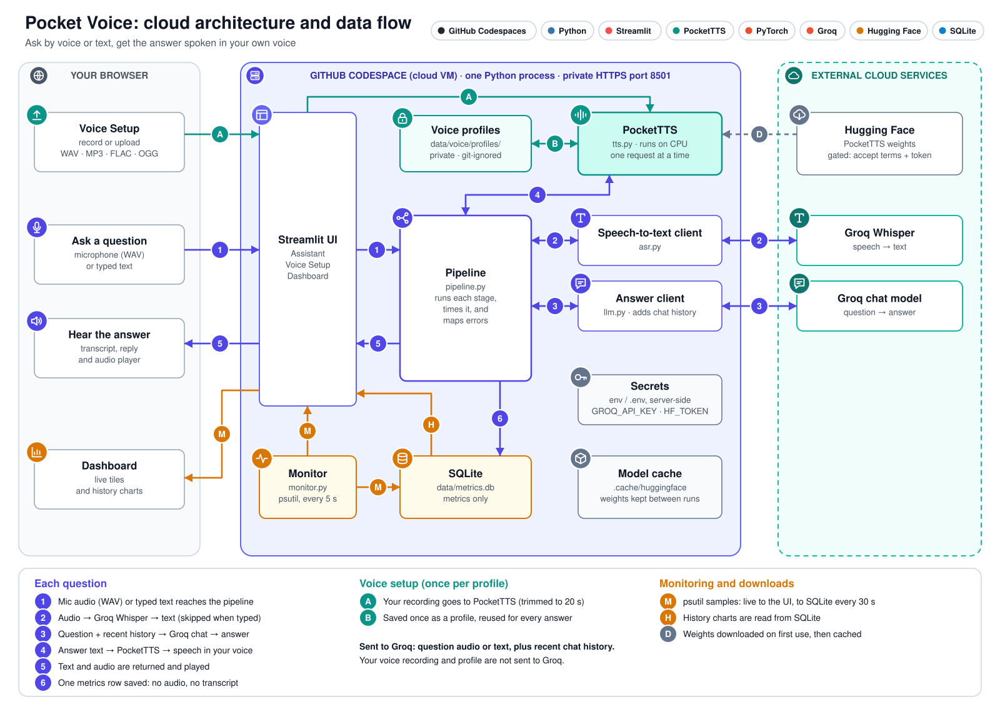

<div align="center">

# 🎙️ Pocket Voice

**A voice assistant that answers in _your own voice_.**
Speak or type a question → hear the answer in a voice cloned from a short recording of you,
with a live dashboard showing CPU, memory and latency.

[PocketTTS](https://github.com/kyutai-labs/pocket-tts) · [Groq](https://console.groq.com/docs) · [Streamlit](https://streamlit.io) · psutil · SQLite

</div>

> ⚠️ Use only your **own** voice, or a voice you have **explicit, lawful permission** to use. All speech is **AI-generated**.
>
> ℹ️ This app **clones** your voice from a short recording (no training). PocketTTS also ships **training / fine-tuning code** for people with a GPU: see [Train or fine-tune](#-train-or-fine-tune-advanced).

---

## 📚 Contents

| Start here | Your voice | Reference |
|---|---|---|
| [1. Aim](#-aim) | [6. Record a good sample](#step-1--record-a-good-sample) | [13. Settings](#-customize-the-app) |
| [2. Architecture & data flow](#-architecture-and-data-flow) | [7. Clean the audio](#step-2--clean-the-audio) | [14. Size & data](#-size-resources-and-data) |
| [3. About PocketTTS](#-about-pockettts) | [8. Create, compare, tune](#step-3--create-the-voice-profile) | [15. Dashboard](#-the-dashboard) |
| [4. Quick start](#-quick-start-github-codespaces) · [Fast replies](#-fast-natural-replies) · [Live answers](#-live-answers-web-search) · [Share a link](#-share-a-public-link) | [9. Clear / delete](#step-6--clear-delete-or-reset-a-voice) | [16. Tests & benchmark](#-tests-and-benchmark) |
| [5. Using the app](#-using-the-app) | [10. Enhance](#-enhance-the-result) | [17. Privacy](#-privacy-and-responsible-use) |
| | [11. Train](#-train-or-fine-tune-advanced) | [18. Troubleshooting](#-troubleshooting) |
| | [12. PocketTTS command line](#-use-pockettts-from-the-command-line) | [19. Licenses & sources](#-licenses-and-sources) |

---

## 🎯 Aim

| Goal | How |
|---|---|
| **Your voice, quickly** | A 10–20 s recording becomes a reusable voice profile. No training run, no GPU. |
| **Small footprint** | Speech recognition and the language model run on Groq. Only the speech model runs in your Codespace. |
| **Visible performance** | A dashboard measures CPU, memory, disk, network and the latency of every stage. |
| **Easy to run** | One Python app. No Docker, database server, Prometheus, Grafana or Kubernetes required. |

**What you get:** 🎤 Voice Setup (record with an on-screen reading passage, or upload WAV/MP3/FLAC/OGG) · 💬 Assistant (microphone **or** typed chat, spoken replies, history) · 📊 Dashboard · 🧪 automated tests and a benchmark script.

---

## 🧱 Architecture and data flow



### Voice setup (once per profile)

| # | Data | From → To |
|---|---|---|
| A | Your recording (WAV/MP3/FLAC/OGG) | Browser → app → PocketTTS. The app trims it to 20 s and boosts it if quiet. |
| B | Voice state (`profile.safetensors`) | PocketTTS → `data/voice/profiles/<name>/`. Reused for every answer. |

### Each question

| # | Stage | What happens | Data sent outside |
|---|---|---|---|
| 1 | Ask | Browser sends microphone audio (WAV) or typed text. Silent audio is rejected. | none |
| 2 | Transcribe | Groq Whisper returns text. Skipped for typed questions. | question audio → Groq |
| 3 | Answer | A Groq chat model replies using your system prompt and recent history. With [live answers](#-live-answers-web-search) on, it first fetches fresh data. | question + history → Groq; search words → web services |
| 4 | Speak | PocketTTS turns the reply into speech in your voice, on CPU. | none |
| 5 | Play | Text and audio go back to your browser. | none |
| 6 | Measure | One row of timings and counts is saved to SQLite. | none |

**Monitoring:** a background thread samples psutil every 5 s (live tiles read it from memory) and writes one row to SQLite every 30 s for history charts.

### Code map

| File | Responsibility |
|---|---|
| [app/Home.py](app/Home.py), [app/chat_style.py](app/chat_style.py) | Assistant page: one chat box with a mic → answer → audio; its look |
| [app/pages/1_Voice_Setup.py](app/pages/1_Voice_Setup.py) | Manage voices: create, test, set default, delete |
| [app/auth.py](app/auth.py), [scripts/expose.py](scripts/expose.py) | Passwords and permissions; public link for `--expose` |
| [app/pages/2_Dashboard.py](app/pages/2_Dashboard.py) | System and voice analytics |
| [app/pipeline.py](app/pipeline.py) | One turn: ASR → LLM → TTS, timing, error categories |
| [app/tts.py](app/tts.py) | PocketTTS model, named voice profiles, tuning |
| [app/quality.py](app/quality.py) | Recording score and silence trimming |
| [app/effects.py](app/effects.py) | Pitch, speed and noise cleanup of the spoken audio |
| [app/similarity.py](app/similarity.py) | Match score between the original recording and the AI voice |
| [app/asr.py](app/asr.py), [app/llm.py](app/llm.py) | Groq calls (optional local Whisper) and the tool-calling loop |
| [app/sentences.py](app/sentences.py), [app/player.py](app/player.py) | Cut the streaming answer into sentences; play audio pieces in the browser |
| [app/cards.py](app/cards.py) | Link cards and pictures shown with an answer |
| [app/live.py](app/live.py) | Live-data tools: search, web pages, news, office holders, markets, weather |
| [app/audio.py](app/audio.py) | Decode, trim, level check and boost |
| [app/monitor.py](app/monitor.py), [app/store.py](app/store.py) | psutil sampling and SQLite storage |
| [app/config.py](app/config.py), [app/errors.py](app/errors.py), [app/ui.py](app/ui.py) | Settings and `.env`, error types, page styling and password |

---

## 🔬 About PocketTTS

[PocketTTS](https://github.com/kyutai-labs/pocket-tts) is Kyutai's lightweight text-to-speech model with voice cloning. The figures below are **Kyutai's published claims**, not measurements from this project.

| | According to the [PocketTTS README](https://github.com/kyutai-labs/pocket-tts#readme) |
|---|---|
| Size | ~100M parameters. Smaller English models down to 1.9M parameters. |
| Hardware | Runs on CPU, uses 2 CPU cores. No GPU needed to generate speech. |
| Speed | ~200 ms to the first audio chunk; ~6× faster than real time on a MacBook Air M4 |
| Languages | English, French, German, Portuguese, Italian, Spanish, Dutch |
| Voices | Voice cloning from an audio sample, plus a catalog of preset voices |
| Python | 3.10 – 3.14, PyTorch 2.5+ (this project uses Python 3.10–3.12) |
| Not supported | Inserting silences/pauses through the text input |

Read more: [demo](https://kyutai.org/pocket-tts) · [model card](https://huggingface.co/kyutai/pocket-tts) · [Python API docs](https://kyutai-labs.github.io/pocket-tts/API%20Reference/python-api/) · [paper](https://arxiv.org/abs/2509.06926)

**How cloning works:** the model reads your sample once and produces a **voice state**. Saving it as a `.safetensors` file makes later loading fast. Your sample is not used to change the model's weights.

**This app uses:** the default English model, voice cloning, saved voice states and int8 quantization (optional). Fast replies also use its streaming generation. It does **not** use other languages, preset voices or GPU.

---

## 🚀 Quick start (GitHub Codespaces)

### 1. Get access to the voice-cloning model
The cloning weights are **gated**.
1. Sign in at Hugging Face, open [kyutai/pocket-tts](https://huggingface.co/kyutai/pocket-tts) and **accept the terms**.
2. Create a token at [Settings → Tokens](https://huggingface.co/settings/tokens) using the **Read-Only** preset.

### 2. Get a Groq API key
Create one at [console.groq.com](https://console.groq.com).

### 3. Add Codespaces secrets
Repository → *Settings → Secrets and variables → Codespaces*:

| Secret | Required | Purpose |
|---|---|---|
| `GROQ_API_KEY` | ✅ | Speech recognition and answers |
| `HF_TOKEN` | ✅ | Download the voice-cloning weights |
| `TAVILY_API_KEY` | optional | More dependable [web search](#-live-answers-web-search) |
| `APP_PASSWORD` | optional | Password gate for the app |
| `ADMIN_PASSWORD` | optional | Manage voices on a [public link](#-share-a-public-link) |

Add them **before** creating the Codespace, or restart it afterwards. (Alternative: `cp .env.example .env` and fill it in.)

### 4. Create the Codespace
*Code → Codespaces → Create codespace on main* (4-core recommended). The devcontainer installs everything, including CPU-only PyTorch.

### 5. Start
```bash
./run.sh
```
Open port **8501** from the **Ports** tab. Keep it **Private**.

### 6. First use
**Voice Setup** → create your voice → **▶ Test** it → **Assistant** → ask by mic or chat → **Dashboard**.

<details>
<summary><b>Run locally (macOS / Linux, not yet tested)</b></summary>

```bash
uv sync
cp .env.example .env      # add GROQ_API_KEY and HF_TOKEN
./run.sh
```
The app reads `.env` itself. See [Size](#-size-resources-and-data) for disk needs.
</details>

<details>
<summary><b>Run with Docker (not yet tested)</b></summary>

```bash
docker build -t pocket-voice .
docker run -e GROQ_API_KEY=... -e HF_TOKEN=... -p 8501:8501 -v pv-data:/data pocket-voice
```
</details>

---

## ⚡ Fast, natural replies

With **Fast reply** on (Assistant page, on by default) the steps overlap instead of waiting for each other:

```
before:  [transcribe] → [write the whole answer] → [make all the audio] → ▶ play
now:     [transcribe] → [write sentence 1] → ▶ speak it while sentence 2 is written → …
```

| Technique | What it does |
|---|---|
| Sentence-by-sentence | Each sentence is spoken as soon as it is written |
| Streaming speech | Audio plays in small pieces while PocketTTS is still generating |
| Fillers | If the answer takes more than about 0.7 s, a short "let me check" plays in your voice |
| Warm-up | The model, your default voice and the fillers are prepared when the app starts |
| Spoken style | The built-in prompt asks for short, natural, conversational replies |

Each reply shows **first words after … s**, and the dashboard shows the average.

- **Still push-to-talk:** it doesn't listen while it speaks and you can't interrupt it by talking.
- **Slow machines:** if speech is generated slower than it plays, you'll hear small gaps. Keep `POCKET_STEPS=1`, try `POCKET_QUANTIZE=1`, use a 4-core Codespace, or switch Fast reply off.
- **Your own `SYSTEM_PROMPT`** in `.env` replaces the built-in style. Leave it blank to use the new one.

---

## 🔎 Live answers (web search)

A language model only knows what existed when it was trained. With **Search the web for fresh facts** switched on (Assistant page, on by default), the model can fetch current information before answering. **Nothing is trained**: data is fetched at the moment you ask.

```
your question → model picks tools → search / read / look up → model writes the answer → your voice
```

| Tool | Source | Key needed | Good for |
|---|---|---|---|
| Web search | Tavily if `TAVILY_API_KEY` is set, otherwise DuckDuckGo, then Google News + Wikipedia | optional | companies, apps, products, current facts |
| Read a web page | the site itself | no | "what is on python.org?" |
| Current office holder | Wikipedia | no | "who is the US president / Telangana CM?" |
| News | Google News (last 7 days) | no | headlines |
| Facts | Wikipedia | no | background |
| Market prices | Yahoo Finance (may be delayed) | no | Nifty, Sensex, NSE shares, gold, crypto, currency |
| Weather | Open-Meteo | no | today and tomorrow |

**More detail:** the app opens the top 2 search results and gives the model the sentences that match your question. It waits at most 4 seconds; set `WEB_DETAILS=0` for faster, shorter answers. Ministers without their own Wikipedia page are read from the ministry's page. If a lookup request fails, the app answers from what it has already found.

**India first** (defaults): `LIVE_REGION=IN` and `APP_TIMEZONE=Asia/Kolkata` give Indian news and search results, NSE listings first, rupees (lakh/crore) and IST. Change them for another country.

**Get a Tavily key (recommended).** DuckDuckGo often blocks automated searches. [Tavily](https://tavily.com) lists 1,000 free searches a month with no card. Add it as `TAVILY_API_KEY` (Codespaces secret or `.env`) and restart.

Each answer lists its **sources** as links. Check anything important.

### 🖼️ Links and pictures on screen
With web search on, the answer is **spoken** while the screen **shows** what was found:
- **Link cards** with a title, short description and picture (up to 4)
- **Pictures** from Wikipedia, a page's preview image, or Tavily image results
- Try: "Show me the Taj Mahal", "What is python.org?", "Who is the Prime Minister of India?"

The voice never reads web addresses aloud. Links and pictures come only from fetched data, never from the model's own text. Pictures load in your browser straight from the source site, which can see that your browser requested them. They may be copyrighted: check before reusing them.

**Caching.** Repeat lookups are answered from a small in-memory cache, which is faster and easier on free rate limits: market prices for 1 minute, news 5 minutes, search, pages and weather 10 minutes, Wikipedia and office holders 1 hour. It holds up to 200 results and empties on restart. **Redis isn't needed** for a single app; it would only help if you ran several copies sharing one cache, or needed the cache to survive restarts.

**Limits and safety**
- Search words and requested pages go to the services above. Switch it off for private questions.
- Web pages can be wrong or try to mislead the model. The tools only read, only public web addresses are contacted, and a page can be opened only if you named the site, or it came from the search.
- Answers take longer and use more Groq tokens, so free plans may hit rate limits sooner.
- Free services are rate limited and their terms apply (several are meant for personal, non-commercial use). Market data is not investment advice.
- Telugu or Hindi **speech** is separate: see [Next phases](docs/NEXT_PHASES.md).

---

## 🌐 Share a public link

By default the app is **private** (your machine or your Codespaces forwarded port). A public link is created **only** when you ask for it:

```bash
./run.sh --expose        # -expose also works
```

The terminal prints something like:
```
PUBLIC LINK: https://random-words.trycloudflare.com
Password to share        : <generated>
Admin password (keep it) : <generated>
```
Send people the link and the **password to share**. Press `Ctrl+C` to close the link. Stop any running `./run.sh` first.

| On the public link | Visitor password | Admin password |
|---|---|---|
| Ask by voice or text, choose a voice, hear answers, see the dashboard | ✅ | ✅ |
| Test a saved voice | ✅ | ✅ |
| Edit the system prompt | ❌ | ✅ |
| Create, replace, delete or set the default voice | ❌ | ✅ (unlock on the Voice Setup page) |

- **How it works:** a free [Cloudflare quick tunnel](https://developers.cloudflare.com/cloudflare-one/connections/connect-networks/do-more-with-tunnels/trycloudflare/), no account needed. The first time, the script downloads `cloudflared` (pinned version, 20–40 MB, SHA-256 verified) into `.cache/bin/`, unless it is already installed.
- **Your own passwords:** set `APP_PASSWORD` and `ADMIN_PASSWORD` (different, at least 12 characters). Otherwise new ones are generated on every start.
- **Temporary:** the address changes each time and works only while the command runs. Quick tunnels are meant for testing, without an uptime guarantee.
- **Microphone:** the link is HTTPS, so visitors' browsers can record.
- **Wrong passwords:** after several failures, password entry is locked for a minute for everyone.

> ⚠️ **Anyone with the password can make your cloned voice say what they like** (by asking the assistant to repeat it) and use your Groq quota. Share only with people you trust, never publish the password, and close the link when you are done. Voice cloning or impersonation without consent is [prohibited](https://github.com/kyutai-labs/pocket-tts#prohibited-use).

---

## 🧭 Using the app

| Page | What to do |
|---|---|
| **Voice Setup** | See your voices: **▶ Test**, **⭐ Make default** or **🗑 delete** each one. To add one: name it, pick a reading passage, tick consent, record or upload, keep the takes you like, click **Create voice**. **Compare** picks style, pitch, speed and noise cleanup. |
| **Assistant** | Choose **Answer in this voice**. Type in the chat box at the bottom, **or** tap the mic on its right: a *Listening* banner appears, tap **✓** to send or **✕** to cancel. Each answer shows which voice spoke it. Edit the system prompt or clear the conversation in the sidebar. |
| **Dashboard** | Choose 15 min, 1 hour or 24 hours. **System** shows resources; **Voice & usage** shows latency, requests and errors. |

🎤 **Microphone silent?** Open the app in a normal browser tab (not VS Code's preview), allow the mic, pick the right input device, or upload a file instead. Connecting desktop VS Code to the Codespace and opening `http://localhost:8501` is another option.

---

# 🎛️ Your voice, step by step

## Step 1 · Record a good sample

The model copies the sound of your sample, **including its noise**, so this step matters most.

- 🔇 Quiet room, no music, TV, fan or echo.
- 🎙️ Decent microphone, about a hand's width from your mouth, no popping.
- 🗣️ One speaker, natural pace, in the **tone you want the assistant to have**.
- ⏱️ **12–20 seconds** of speech without long pauses. Wait a second before you start: silence at the ends is cut, then the **first 20 s** are used.
- ➕ **Compare takes:** record up to three, click **Keep this take** for each, and build the voice from the best one. Each recording gets a score out of 100 with tips (length, volume, background noise, distortion).
- 📖 Read one of the on-screen passages ("Everyday", "Varied sounds", "Conversational").

| Accepted | Not accepted |
|---|---|
| WAV, MP3, FLAC, OGG · at least 5 s · up to 10 min (trimmed) | M4A/AAC, silent files |

Convert an iPhone/Voice Memos `.m4a` on a Mac:
```bash
afconvert -f WAVE -d LEI16@16000 -c 1 in.m4a my_voice.wav
```

## Step 2 · Clean the audio

**Done automatically by the app:** decoding MP3/FLAC/OGG, cutting silence at the start and end, trimming to 20 s, boosting quiet recordings to a normal level, and rejecting silence. With noise reduction on, rumble below 60 Hz is removed too.

**Built-in noise reduction:** on Voice Setup choose **Reduce background noise** → `light`, `medium` or `strong`, listen to *Original* and *Cleaned*, then click **Create voice**. Start with `light`; if your voice sounds metallic or muffled, go lighter. Set a default with `POCKET_DENOISE` in `.env`.

| Helps with | Does not remove |
|---|---|
| Steady noise: fan, air conditioner, hiss, hum | Other people talking, TV, music, sudden sounds, echo |

It learns the noise from the quietest parts of your clip, so leave short natural pauses. It cleans **new voice samples only**: re-create an existing voice to apply it. Your spoken questions are not filtered.

For other kinds of noise, re-record, or use one of these:

**Option A: clean locally with [Audacity](https://www.audacityteam.org/)** (free, nothing uploaded; menu names vary slightly by version)
1. Open your recording.
2. Select 1–2 s containing **only background noise**.
3. *Effect → Noise Removal and Repair → Noise Reduction* → **Get Noise Profile**.
4. Select all (`Ctrl/Cmd + A`), open Noise Reduction again and apply a **moderate** amount. Too much sounds metallic.
5. Cut mistakes, coughs and long silences. Keep your best 10–20 s.
6. *Effect → Normalize* to about −3 dB.
7. *File → Export* as **WAV, 16-bit PCM, mono**.

**Option B: online enhancer.** Kyutai recommends cleaning samples with [Adobe Podcast Enhance](https://podcast.adobe.com/en/enhance).
> 🔒 This uploads your voice to a third party. Check their terms first.

## Step 3 · Create the voice profile

**In the app:** Voice Setup → *Add or replace a voice* → enter a **name** (for example `me-calm`, `me-energetic`) → tick consent → record or upload → **Create voice**.

- Keep as many voices as you like. Using an existing name replaces that voice.
- **Make this the default voice** (or **⭐ Make default** later) sets the voice used unless someone picks another.
- On the **Assistant** page, **Answer in this voice** chooses the voice for your session only.

**From the command line** (optional), run from the project folder:
```bash
uv run python - <<'EOF'
import sys; sys.path.insert(0, "app")
import tts
from audio import decode_to_wav
audio = decode_to_wav(open("my_voice_clean.wav", "rb").read())
print(tts.build_profile(audio, name="studio", make_active=False))
EOF
```
Manage them:
```bash
uv run python -c 'import sys; sys.path.insert(0,"app"); import tts; print([p["name"] for p in tts.list_profiles()], "active:", tts.active_profile())'
uv run python -c 'import sys; sys.path.insert(0,"app"); import tts; tts.set_active("studio")'
```
The running app uses the new active profile from the next answer.

## Step 4 · Test and compare

**In the app:** Voice Setup → *Find the best-sounding settings*. Pick what to compare, click **Compare**, listen, then **Use this**:

| Compare | Choices |
|---|---|
| Original vs AI | Your recording next to the AI voice as it sounds now (**Check match**) |
| Speaking style | Current, Steady, Natural, Expressive |
| Pitch | Much deeper to much higher (±3 semitones) |
| Speed | Slow to fast |
| Noise cleanup | Off, Light, Medium, Strong |
| Mix your own | Sliders for all settings, then **Preview** |

**Match score.** Every AI version is scored from 0 to 100 against your original recording, and the closest is marked ⭐. It compares **tone** (the shape of the sound) and **pitch** using plain numpy, with no extra model. It ignores words, speaking speed and naturalness, and it is not speaker verification. Its scale was set with computer-made system voices, so judge **differences between versions** rather than the number alone, and let your ears decide. Background noise and a short test sentence lower reliability.

**Each voice keeps its own choice**, saved with it, and it wins over `.env`. A newly created voice is selected here automatically. **↺ Reset** returns that voice to the defaults. Nothing needs editing in files.

**From the command line:**

Generate the same sentence with different profiles and settings, then listen:
```bash
uv run python - <<'EOF'
import sys, time; sys.path.insert(0, "app")
import tts
text = "The weather looks great today, so let's take a short walk."
for name in ("default", "studio"):
    for steps in (1, 3):
        t = time.time()
        wav, secs = tts.synthesize(text, profile=name, tuning={"temp": 0.4, "steps": steps})
        open(f"compare_{name}_steps{steps}.wav", "wb").write(wav)
        print(f"{name} steps={steps}: {time.time() - t:.1f}s to make {secs:.1f}s of audio")
EOF
```
Download the `compare_*.wav` files from the Codespaces file explorer. (`*.wav` is git-ignored.) The first line of output includes model loading time.

## Step 5 · Tune how it speaks

| Setting | Default | Range in this app | Effect (per PocketTTS docs) |
|---|---|---|---|
| `temp` | 0.3 | 0.05 – 1.5 | Higher is **more expressive** and more varied |
| `steps` (sampler decode steps) | 1 | 1 – 8 | More steps can improve **quality** but are slower |
| `eos_threshold` | −4.0 | −10 – 5 | End-of-speech detection. **Lower** finishes earlier (fixes rambling); **higher** continues longer (fixes cut-off endings) |
| `pitch` | 0 | −4 – 4 | Semitones deeper or higher. Beyond ±1.5 it sounds less like you |
| `speed` | 1.0 | 0.75 – 1.3 | Slower or faster, without changing pitch |
| `clean` | off | off, light, medium, strong | Removes steady noise (hiss, hum) from the **spoken replies** |

`pitch`, `speed` and `clean` process the finished audio, so with **Fast reply** each sentence is completed before it plays.

**Option 1: set them in `.env`** (or as environment variables), then restart the app:
```ini
POCKET_TEMP=0.5
POCKET_STEPS=2
POCKET_EOS_THRESHOLD=-4
```
These apply to voices you **haven't tuned in the app**, and override the shared file below, one setting at a time. Pitch, speed and noise cleanup are chosen in the app only.

**Option 2: save a choice from the command line** for one voice (add `voice="name"`), or for all untuned voices (applies from the next answer, no restart):
```bash
uv run python -c 'import sys; sys.path.insert(0,"app"); import tts; print(tts.save_tuning({"temp": 0.6, "steps": 2}))'
```
Reset to defaults:
```bash
uv run python -c 'import sys; sys.path.insert(0,"app"); import tts; tts.reset_tuning(); print(tts.get_tuning())'
```
Settings you leave out of `save_tuning` return to their defaults. A voice's choice is stored in `data/voice/profiles/<name>/tuning.json`, the shared one in `data/voice/tuning.json`. Kyutai's examples: `steps 5, temp 0.5` for higher quality; `temp 1.0` for more expression.

## Step 6 · Clear, delete or reset a voice

| What you want | How |
|---|---|
| Replace a voice | Voice Setup → create a voice with the **same name** |
| Delete a voice | Voice Setup → **🗑** next to it → **Yes, delete** |
| Delete from the command line | `uv run python -c 'import sys; sys.path.insert(0,"app"); import tts; tts.delete_profile("studio")'` |
| Clear the **chat** | Assistant sidebar → **Clear conversation** |
| Delete **all voices and tuning** | `rm -rf data/voice` ⚠️ permanent |
| Delete **analytics** | stop the app, then `rm data/metrics.db*` ⚠️ permanent |
| Delete **downloaded models** | `rm -rf .cache/huggingface` (downloads again next time) |

Also delete any loose recordings and `compare_*.wav` files you created.

---

## ✨ Enhance the result

| Problem | Try |
|---|---|
| Doesn't sound like me | Re-record closer to the mic in a quiet room, 10–20 s, natural tone. Make several profiles and compare. |
| Noisy, hissy or muffled output | The sample's quality is copied. Clean it (Step 2) or use a better mic. |
| Sounds like reading aloud / flat | Record the sample in a conversational tone; try `temp` 0.5–0.8. |
| Unstable or odd intonation | Lower `temp` (0.2–0.3). |
| Words cut off at the end | Raise `eos_threshold` (e.g. −3). |
| Extra sounds after the sentence | Lower `eos_threshold` (e.g. −5). |
| Pronunciation of names or acronyms | Spell them the way they sound; ask for plain wording in the system prompt. |
| Too slow | Enable quantization, keep `steps` at 1, use shorter answers. |

### Make it faster or smaller
- **Quantization:** set `POCKET_QUANTIZE=1` and restart. Kyutai reports runtime memory falling from about 450 MB to 234 MB and about 1.27× faster on x86, with no measurable quality loss ([details](https://github.com/kyutai-labs/pocket-tts/blob/main/docs/quantization.md)). Faster kernels: `uv add "pocket-tts[quantize]"` (needs PyTorch 2.10+).
- **Other models** (small code edit, untested here): in `_get_model()` in [app/tts.py](app/tts.py), add a language:
  ```python
  _model = TTSModel.load_model(language="english_2m_2026-10", quantize=get_settings().quantize)
  ```
  Options include `english_18m_2026-10`, `english_7m_2026-10`, `english_2m_2026-10` and other languages such as `french`. **Re-create your voice profiles** after changing models, because a voice state belongs to the weights that made it. Check quality and cloning support for the model you pick.
- **GPU:** not supported by this app. Kyutai notes a speed-up on some weaker CPUs ([details](https://github.com/kyutai-labs/pocket-tts#running-on-gpu)).

---

## 🏋️ Train or fine-tune (advanced)

📘 **Detailed step-by-step guide for training on your own recordings: [docs/TRAINING.md](docs/TRAINING.md).**

> **Do you need this?** For making the assistant sound like **you**, usually **no**. Cloning (Steps 1–5) is the intended way. Training is for new languages, large new datasets or new domains.
>
> Summarised from Kyutai's [training guide](https://github.com/kyutai-labs/pocket-tts/blob/main/training/README.md). **None of this has been run for this project.** It does not run in this app or on a standard Codespace.

### Requirements
| Item | What the guide says |
|---|---|
| System | Linux |
| GPU | One NVIDIA GPU. Default batch needs ~56 GB; `batch_size: 16` with `grad_accum_steps: 4` fits ~16 GB |
| Disk | ~60 GB per 1,000 hours of prepared audio |
| Data | Speech **with transcripts**. For a new language or from scratch: at least 100 h, ideally 1,000+ h. The guide gives **no minimum** for fine-tuning one person's voice. |
| Rights | Only audio you are allowed to use |

### Steps
**1. Get the code** (on the GPU machine)
```bash
git clone https://github.com/kyutai-labs/pocket-tts.git
cd pocket-tts
uv sync
```
**2. Describe your data** in `data/train.jsonl` and `data/valid.jsonl`, one clip per line:
```json
{"path": "/data/clips/0001.wav", "duration": 7.4, "transcript": "The words spoken in this clip."}
```
Accurate transcripts matter: the guide says wrong text makes the model stop following the script.

**3. Add word timings** (forced alignment)
```bash
uv run python -m training.scripts.align_data data/train.jsonl data/train_aligned.jsonl --device cuda
uv run python -m training.scripts.align_data data/valid.jsonl data/valid_aligned.jsonl --device cuda
```
The default aligner is English; pass `--model` for other languages.

**4. Configure** `training/configs/finetune.yaml`. It continues from the pretrained English teacher with 20,000 steps. On a 16 GB GPU set:
```yaml
batch_size: 16
grad_accum_steps: 4
```
(For a different language use `finetune_language.yaml`.)

**5. Train**
```bash
uv run training/train.py training/configs/finetune.yaml
```
Results appear in `runs/finetune/`: checkpoints, `model.safetensors`, `progress.jsonl` and audio `samples/`.

**6. Listen**
```bash
uv run pocket-tts generate --config pocket_tts/config/english_2026-04_24l.yaml \
    --checkpoint runs/finetune/checkpoint_00020000.pt \
    --voice my_voice.wav --text "Hello there."
```
(Use the checkpoint file name your run produced.)

**7. Shrink for CPU (recommended).** The fine-tuned model is a 24-layer "teacher" (the released 24-layer English weights are ~1.3 GB). Distil it to 6 layers with `training/configs/depth_distill.yaml`, following the guide.

**8. Evaluate** word error rate, speaker similarity and audio quality with `training/eval/librispeech.py`.

**9. Use it in this app** (code edit, untested): in `_get_model()` in [app/tts.py](app/tts.py), load your files, then delete and re-create your voice profiles:
```python
_model = TTSModel.load_model(config="/path/to/my_config.yaml", checkpoint="/path/to/checkpoint.pt")
```

---

## 💻 Use PocketTTS from the command line

These come from the `pocket-tts` package, independent of the app. The command line does not read this project's `.env`, so run `export HF_TOKEN=...` first if it isn't a Codespaces secret.

```bash
# Speak text in your voice
uv run pocket-tts generate --voice my_voice.wav --text "Hello from my voice." --output-path out.wav

# Convert a sample into a reusable voice file (first 30 s are used)
uv run pocket-tts export-voice my_voice.wav my_voice.safetensors

# Reuse the app's saved profile
uv run pocket-tts generate --voice data/voice/profiles/default/profile.safetensors --text "Hi!"

# Tuning flags
uv run pocket-tts generate --voice my_voice.wav --temperature 0.6 --sampler-decode-steps 3 --eos-threshold -3 --quantize

# PocketTTS's own web demo (port 8000)
uv run pocket-tts serve
```
Preset voices work without cloning access, for example `--voice alba`, `marius` or `jean`. Each has its own license: see [kyutai/tts-voices](https://huggingface.co/kyutai/tts-voices).

Docs: [generate](https://kyutai-labs.github.io/pocket-tts/CLI%20Commands/generate/) · [export-voice](https://kyutai-labs.github.io/pocket-tts/CLI%20Commands/export_voice/) · [serve](https://kyutai-labs.github.io/pocket-tts/CLI%20Commands/serve/)

---

## 🛠️ Customize the app

Put settings in `.env` (copy [.env.example](.env.example)), your shell, Docker `-e` or Codespaces secrets. Existing environment variables win over `.env`; blank `.env` values are ignored. **Restart after changes.**

| Variable | Default | Changes |
|---|---|---|
| `GROQ_API_KEY` | none | **Required** |
| `HF_TOKEN` | none | **Required for cloning** |
| `GROQ_LLM_MODEL` | `openai/gpt-oss-20b` | Answer model (`openai/gpt-oss-120b` is the larger option). The older Llama models were retired for free and developer plans on 16 August 2026 and return 404. |
| `GROQ_ASR_MODEL` | `whisper-large-v3-turbo` | Speech recognition (`whisper-large-v3`) |
| `ASR_BACKEND` | `groq` | `local` runs faster-whisper after `uv sync --extra local-asr` |
| `SYSTEM_PROMPT` | short spoken answers | Personality and style (also editable in the sidebar) |
| `HISTORY_TURNS` | `6` | Chat memory; `0` disables |
| `REQUEST_TIMEOUT_S` | `30` | Groq timeout |
| `POCKET_QUANTIZE` | `0` | `1` enables int8 quantization |
| `POCKET_DENOISE` | `off` | Default noise reduction for new voices: `off`, `light`, `medium`, `strong` |
| `FAST_REPLY` | `1` | Speak while the answer is being written |
| `FILLERS` | `1` | Short waiting phrases in your voice |
| `POCKET_WARMUP` | `1` | Load the voice model at startup |
| `LIVE_DATA` | `1` | Web search switch on by default (`0` = off) |
| `TAVILY_API_KEY` | blank | Dependable web search |
| `WEB_DETAILS` | `1` | Open the top 2 search results for more detail (`0` = faster) |
| `LIVE_REGION` | `IN` | Country for news and search |
| `APP_TIMEZONE` | `Asia/Kolkata` | Time zone for today's date |
| `POCKET_TEMP`, `POCKET_STEPS`, `POCKET_EOS_THRESHOLD` | blank (0.3, 1, −4) | Starting values for voices not tuned in the app: see [Step 5](#step-5--tune-how-it-speaks) |
| `DATA_DIR` | `./data` | Voices and database location |
| `RETENTION_DAYS` | `14` | Age limit for samples and errors |
| `SAMPLE_INTERVAL_S` | `5` | Monitoring interval |
| `APP_PASSWORD` | empty | Require a password (generated for `--expose` if empty) |
| `ADMIN_PASSWORD` | empty | Manage voices on a public link (generated for `--expose` if empty) |
| `PORT` | `8501` | Port used by `run.sh` (shell variable) |

| Code change | Edit |
|---|---|
| Sample length limits, spoken text limit (800 chars), tuning ranges | `MIN_REF_S`, `USE_REF_S`, `MAX_INPUT_S`, `MAX_TEXT_CHARS`, `_LIMITS` in [app/tts.py](app/tts.py) |
| Silence level and boost target | `SILENCE_RMS`, `TARGET_DBFS` in [app/audio.py](app/audio.py) |
| Answer length and creativity | `max_completion_tokens`, `temperature` in [app/llm.py](app/llm.py) |
| Reading passages | `PASSAGES` in [app/pages/1_Voice_Setup.py](app/pages/1_Voice_Setup.py) |
| Microphone button size (52 px) and the *Listening* animation | `MIC_SIZE_PX` and the CSS in [app/chat_style.py](app/chat_style.py) |
| Colours and theme | [.streamlit/config.toml](.streamlit/config.toml), `_CSS` in [app/ui.py](app/ui.py) |
| Dashboard ranges and chart colours | `RANGES`, `C` in [app/pages/2_Dashboard.py](app/pages/2_Dashboard.py) |

---

## 📏 Size, resources and data

### Project (measured, 26 Nov 2026)
| Item | Size |
|---|---|
| Application code | 13 Python files, 1,588 lines, ~65 KB |
| Tests | 9 files, ~650 lines, ~22 KB |
| Repository (tracked files) | ~1.3 MB, mostly one PNG and the slide deck |

### Downloads (Linux x86-64, Python 3.12)
| Item | Download size | Source |
|---|---|---|
| All runtime Python packages (77) | **~400 MB** | Resolved from `pyproject.toml`; wheel sizes from PyPI and PyTorch |
| ↳ PyTorch (CPU) | ~210 MB | largest |
| ↳ pyarrow, scipy, numpy, pandas | ~55, ~35, ~16, ~12 MB | |
| PyTorch with CUDA instead | ~3 GB (avoided) | Kyutai README |
| Default English speech model | **~219 MB** | Hugging Face file listing |
| Smaller models: 18M / 7M / 2M | ~112 / ~67 / ~47 MB | Hugging Face file listing |
| 24-layer model | ~1.3 GB | Hugging Face file listing |

Installed size on disk is larger than the download and has **not been measured**: run `du -sh .venv .cache` in your Codespace.

### Data the app stores
| Data | Where | Size | Kept |
|---|---|---|---|
| Voice sample | `data/voice/profiles/<name>/reference.wav` | ≤ 20 s of audio | until you delete it |
| Voice profile | `…/profile.safetensors` | a few MB (preset voice states are ~6 MB) | until you delete it |
| Tuning, active voice | `data/voice/tuning.json`, `active.txt` | < 1 KB | until reset |
| Metrics database | `data/metrics.db` | **~5 MB** for 14 days of samples + 1,000 requests (measured with generated data) | samples/errors 14 days; request rows kept |
| Model cache | `.cache/huggingface` | model files above | until removed |
| Chat history | browser session memory | n/a | lost on refresh or restart |

**Database tables** (SQLite, a single file, no server):

| Table | Columns |
|---|---|
| `requests` | id, time, ASR/LLM/TTS/total ms, input and output audio seconds, status, error category, model names, token counts, question and answer **lengths** |
| `resource_samples` | time, CPU, app CPU, memory %, app memory, network bytes and rates |
| `errors` | time, category, short message |

**Never stored:** audio of your questions, transcripts or answers.

### Memory and speed
| Metric | Kyutai's figure | Your Codespace |
|---|---|---|
| Runtime memory (model transformer benchmark) | ~450 MB, ~234 MB quantized | _run the benchmark_ |
| Speed vs real time | ~6× (MacBook Air M4); ~3.2× (x86 CI runner) | _run the benchmark_ |
| First audio chunk | ~200 ms (streaming) | _run the benchmark_ |
| End-to-end answer time | n/a | _Dashboard → Voice & usage_ |

---

## 📊 The dashboard

| Tab | Shows |
|---|---|
| **System** | CPU (system, app, per core), memory (system, app, peak), disk, data and model cache size, network, process info, GPU only if present |
| **Voice & usage** | Total/successful/failed questions; average, median and P95 response time (P95 needs 20 successful requests); stage latencies; audio generated; tokens; model usage; recent requests and errors |

Network figures are **system-wide**. In Codespaces the numbers describe the **cloud VM**, not your laptop. Empty ranges show empty states.

---

## 🧪 Tests and benchmark

```bash
uv run pytest -q                                            # Groq is mocked, no paid calls
REF_WAV=my_voice.wav uv run pytest -q -m slow               # real PocketTTS round trip
uv run python scripts/benchmark_tts.py --ref my_voice.wav   # load time, speed, memory, CPU
```
The benchmark saves `data/benchmark.json`.

**Status:** voice profile creation has worked in Codespaces. The automated tests use stand-ins for Groq and the speech model. The benchmark, Docker and local runs have not been verified.

---

## 🔒 Privacy and responsible use

- API keys stay on the server. `.env`, `data/`, `.wav` and `.safetensors` files are git-ignored.
- Voice files are stored with owner-only permissions and are never served by URL.
- Your question audio or text and recent chat history are sent to Groq ([privacy policy](https://groq.com/privacy-policy/)). Your voice sample and profile are not.
- With web search on, search words and page requests also go to Tavily or DuckDuckGo, Google News, Wikipedia, Yahoo Finance or Open-Meteo, as needed.
- Keep the Codespaces port **Private**; consider `APP_PASSWORD`.
- A public link exists only with `./run.sh --expose` and always requires a password: see [Share a public link](#-share-a-public-link).
- **Prohibited by Kyutai:** cloning or impersonating a voice without explicit lawful consent; deception or disinformation, including presenting generated audio as real; unlawful, harmful or abusive content. See [Prohibited use](https://github.com/kyutai-labs/pocket-tts#prohibited-use).

---

## 🩺 Troubleshooting

| Problem | Fix |
|---|---|
| "Could not download the weights for the model with voice cloning" | Accept the terms on the model page, set `HF_TOKEN`, restart |
| "GROQ_API_KEY is not set" | Add the secret or `.env` entry, then restart |
| Groq rejected the key / rate limit | Check the key; wait and retry |
| "Groq could not find the model" (404) | Set `GROQ_LLM_MODEL` to one listed in the error |
| `uv: command not found` | `export PATH="$HOME/.local/bin:$PATH"` |
| `uv sync` times out on `pypi.org` | Retry or recreate the Codespace, or use a mirror you trust: `UV_HTTP_TIMEOUT=120 UV_DEFAULT_INDEX=<mirror-url> uv sync` (don't commit that `uv.lock`) |
| Recording silent | Normal browser tab, allow mic, correct input device, or upload a file |
| "Too short" / "too quiet" | Record 10–20 s, closer to the mic |
| M4A rejected | Convert with the `afconvert` command in Step 1 |
| "No voice profile yet" | Create one in Voice Setup |
| Analytics storage unavailable | Check disk space and `DATA_DIR`; the assistant still works |
| Old or made-up facts | Turn on **Search the web**; check the sources under the answer |
| "Web search unavailable" or weak results | DuckDuckGo is blocking: set `TAVILY_API_KEY` |

---

## ⚠️ Known limitations

- Needs internet for Groq, and is subject to its rate limits.
- Pitch and speed are audio processing, not a new voice: large changes sound artificial. The end-of-speech setting has no slider (use `.env`, for voices not tuned in the app).
- Replies are fast but not a live conversation: press the mic to talk; you can't interrupt by speaking.
- Public links are temporary testing tunnels with shared passwords (no individual user accounts).
- One request is spoken at a time (single-user demo).
- Noise reduction handles steady noise in voice samples only (no removal of other voices). No voice-activity detection or M4A support.
- English model only unless you edit the code. **Telugu and other languages:** see [Next phases](docs/NEXT_PHASES.md).

---

## 📜 Licenses and sources

| Component | License |
|---|---|
| [pocket-tts](https://github.com/kyutai-labs/pocket-tts) code | MIT. **Model weights and each preset voice have their own terms**: read the [model card](https://huggingface.co/kyutai/pocket-tts) and [voice licenses](https://huggingface.co/kyutai/tts-voices). |
| PyTorch | BSD-style |
| Streamlit, Plotly, pandas, psutil, NumPy, soundfile | Apache-2.0 / MIT / BSD (verify before redistributing) |
| `groq` SDK | Apache-2.0 |
| faster-whisper (optional) | MIT |

**Sources** (read 26 Nov 2026): PocketTTS [README](https://github.com/kyutai-labs/pocket-tts#readme), [training guide](https://github.com/kyutai-labs/pocket-tts/blob/main/training/README.md), [generate](https://github.com/kyutai-labs/pocket-tts/blob/main/docs/CLI%20Commands/generate.md), [export-voice](https://github.com/kyutai-labs/pocket-tts/blob/main/docs/CLI%20Commands/export_voice.md), [quantization](https://github.com/kyutai-labs/pocket-tts/blob/main/docs/quantization.md) · [Groq models](https://console.groq.com/docs/models)
