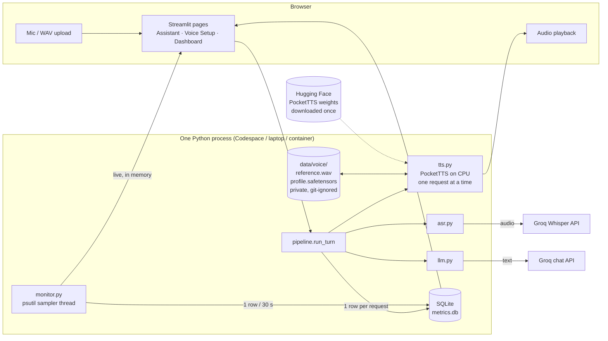

# Pocket Voice

A small voice assistant: you speak, Groq transcribes and answers, and the answer is spoken in **your own voice** with [PocketTTS](https://github.com/kyutai-labs/pocket-tts). It includes a dashboard for CPU, memory, disk, network and per-stage latency.

> **Voice profile ≠ training.** PocketTTS conditions on a short recording and saves a reusable *voice state*. No model weights are fine-tuned. Use only your own voice, or a voice you have explicit permission to use. All speech is AI-generated.

## Why this exists
Pocket Voice is a hands-on demo of a talking assistant that answers in **your own voice**. It shows that a voice assistant with a personal voice can run on a modest CPU machine or a Codespace:
- **Your voice, quickly:** a 10–20 s recording becomes a reusable voice profile. There is no training run and no GPU.
- **Small footprint:** speech recognition and the language model run on Groq, so the machine only runs one compact text-to-speech model.
- **Visible performance:** a built-in dashboard shows CPU, memory, disk, network and the latency of each stage (transcribe, answer, speak), based on real measurements.
- **Simple to run:** a single app with no extra services to set up.

## How it works
1. **Voice setup (once).** You upload or record 10–20 s of speech. PocketTTS encodes it into a *voice state*, which is saved to `data/voice/profile.safetensors`. From then on the state is loaded from disk, and the recording is not re-processed.
2. **Ask a question.** The browser mic (`st.audio_input`) produces a WAV. The app rejects empty or silent audio before any API call.
3. **Transcribe.** The WAV goes to Groq Whisper (`whisper-large-v3-turbo` by default). The recognized text is shown in the chat.
4. **Answer.** The text and recent history go to a Groq chat model with your configurable system prompt. The reply and token usage come back.
5. **Speak.** PocketTTS turns the reply into audio in your voice profile, on CPU. The browser plays it.
6. **Record metrics.** Each stage is timed with `perf_counter`. One row per request goes to SQLite (timings, durations, model names, token counts, error category, text *lengths*). It stores no audio and no transcripts.
7. **Monitor.** A background thread samples psutil every 5 s into memory and writes one row to SQLite every 30 s. The dashboard reads live values from memory, so it works even if the database fails.

## Architecture


| File | Responsibility |
|---|---|
| `app/Home.py`, `app/pages/` | The three Streamlit pages |
| `app/pipeline.py` | One turn: ASR, LLM, TTS, timing, error categories, metrics row |
| `app/tts.py` | Cached PocketTTS model, build/load/delete voice profile, sequential synthesis |
| `app/asr.py`, `app/llm.py` | Groq calls, with an optional local Whisper backend |
| `app/monitor.py` | psutil collectors and the background sampler |
| `app/store.py` | SQLite schema, queries, retention, summary statistics |
| `app/config.py`, `app/errors.py`, `app/audio.py`, `app/ui.py` | Settings from env vars, error types, WAV helpers, page setup and password gate |

## How lightweight is it?
**Measured from this repo:**
- About 1,200 lines of application code in 13 Python files, plus about 340 lines of tests.
- The repo is about 240 KB, with no models or binaries committed.
- One process, one SQLite file. No Docker, Redis, Prometheus, Grafana, Kubernetes, message queue or background service is needed.
- 7 direct dependencies: `pocket-tts`, `torch`, `streamlit`, `plotly`, `pandas`, `psutil`, `groq`. Plus `numpy`, which PyTorch needs anyway.

**By design:**
- **Speech recognition and the language model run in Groq's cloud**, so no local Whisper or LLM is loaded. The local `faster-whisper` backend is an optional extra and is not installed by default.
- **The only local model is PocketTTS**, a ~100M-parameter CPU model per its documentation.
- **CPU-only PyTorch on Linux** comes from the PyTorch CPU wheel index, avoiding the multi-GB CUDA wheels.
- **The voice profile is encoded once and reused**, and the model is loaded once and cached.
- **Idle cost is bounded.** The sampler wakes every 5 s, the database is written every 30 s, and the dashboard refreshes only while that page is open.
- **Requests run one at a time**, so there is no concurrency overhead.
- **The recorder is the browser's.** WAV only, so there is no ffmpeg install.

**Not yet measured.** RAM, CPU and disk for the loaded model are unknown until the benchmark has been run:

| Metric | Result |
|---|---|
| Install size (`.venv`) | _run `du -sh .venv`_ |
| Model download / cache size | _see Dashboard → Details → Model cache_ |
| Model load time | _benchmark_ |
| RSS before / after model load | _benchmark_ |
| Voice-state creation time | _benchmark_ |
| Real-time factor (generation time ÷ audio length) | _benchmark_ |
| Time to first audio | _benchmark_ |
| CPU during speech / idle | _benchmark_ |
| End-to-end latency (ASR + LLM + TTS) | _Dashboard → Voice & usage_ |

Run `uv run python scripts/benchmark_tts.py --ref my_voice.wav` and paste the results into this table. Don't treat the table as filled in until you have.

## Run in GitHub Codespaces (recommended)
1. Add Codespaces secrets: `GROQ_API_KEY` (required) and `APP_PASSWORD` (optional).
2. Create a Codespace (4-core / 8 GB or more). The devcontainer runs `uv sync` (CPU-only PyTorch).
3. `./run.sh`, then open the forwarded port 8501 (keep it **private**; it is HTTPS, so the browser mic works).
4. **Voice Setup**: upload or record 10–20 s of clear speech, tick the consent box, create the profile, and play the test sentence.
5. **Assistant**: click the mic, ask a question, and listen.
6. **Dashboard**: system and voice analytics.

The first profile creation downloads the PocketTTS weights from Hugging Face. They are cached in `.cache/huggingface`, and your profile is saved in `data/`. Both survive a Codespace stop/start.

## Other environments
- **Local (macOS/Linux):** `uv sync && cp .env.example .env` (edit the key), then `./run.sh`. Needs about 1–2 GB of disk for PyTorch and the model.
- **Docker:** `docker build -t pocket-voice . && docker run -e GROQ_API_KEY=... -p 8501:8501 -v pv-data:/data pocket-voice`
- Local, Docker and Windows are **untested so far**. Only the Codespaces path is intended for validation.

## Configuration (environment variables, see `.env.example`)
`GROQ_API_KEY`, `GROQ_ASR_MODEL` (default `whisper-large-v3-turbo`), `GROQ_LLM_MODEL` (default `llama-3.3-70b-versatile`; confirm current IDs in the [Groq docs](https://console.groq.com/docs)), `ASR_BACKEND` (`groq` or `local`), `SYSTEM_PROMPT`, `DATA_DIR`, `RETENTION_DAYS`, `HISTORY_TURNS`, `SAMPLE_INTERVAL_S`, `APP_PASSWORD`.

## Tests and benchmark (run in Codespaces)
```bash
uv run pytest -q                                  # Groq is mocked; no paid calls
REF_WAV=my_voice.wav uv run pytest -q -m slow     # real PocketTTS profile round trip
uv run python scripts/benchmark_tts.py --ref my_voice.wav   # real load time, RTF, RAM, CPU
```
Performance numbers are not claimed here. Run the benchmark and record your results.

## Privacy and security
- The Groq key stays server-side and is never sent to the browser.
- The recording and profile are stored under `DATA_DIR/voice` with owner-only permissions. They are git-ignored, never served by URL, and removable with the **Delete** button.
- Analytics store timings, models, token counts and text *lengths*, never audio or transcripts. Audio and transcripts are not logged.
- Spoken questions are sent to Groq for transcription and answering. Their [terms](https://groq.com/privacy-policy/) apply.

## Dependencies and licenses (verify before redistributing)
| Component | Role | License |
|---|---|---|
| [pocket-tts](https://github.com/kyutai-labs/pocket-tts) | TTS + voice cloning | Code MIT. **Weights and voices have separate licenses: check the [model card](https://huggingface.co/kyutai/pocket-tts).** |
| PyTorch (CPU) | Inference runtime | BSD-style |
| Streamlit, Plotly, pandas, psutil | UI, charts, data, metrics | Apache-2.0 / MIT / BSD |
| groq (SDK) | ASR + LLM API | Apache-2.0 |
| faster-whisper (optional) | Local ASR | MIT |

## Known limitations
- Groq ASR/LLM need internet access and use a third-party API with rate limits.
- Network metrics are system-wide (per-process network isn't available). In Codespaces/Docker, metrics describe the container/VM, not your laptop.
- Voice quality depends on a clean reference clip.
- Upload is WAV-only (16-bit PCM), so the app doesn't need ffmpeg.
- Requests run one at a time (single-user demo). TTS output is generated in full before playback (no streaming in the UI).
- Not implemented: Silero VAD (the browser recorder already has start/stop), Kokoro fallback, and KittenTTS. The decision to use PocketTTS only is deliberate.
